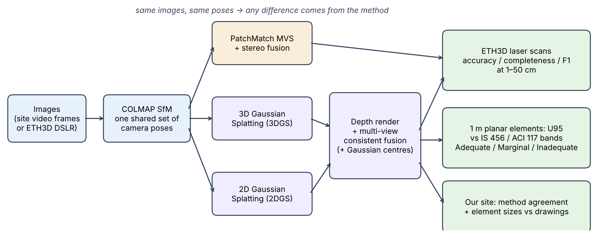
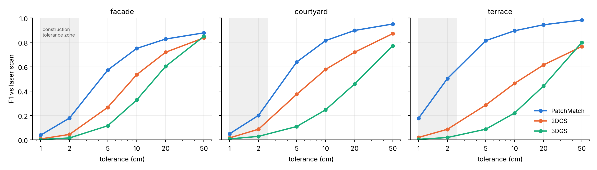
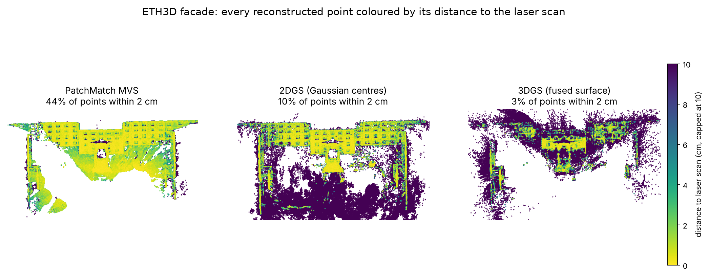
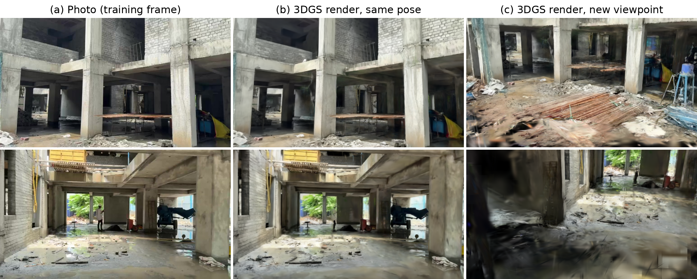
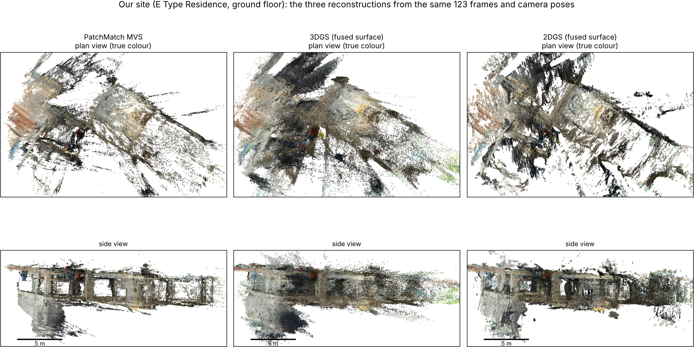

# Can Gaussian Splatting replace PatchMatch MVS for construction QA?

**CV5570 Computer Vision, IIT Madras. Team Byte Me.**
Shubhang Agarwal (CE24B117), Raj Vardhan Waghmare (CE24B127), Shuvo Goswami (CE25M822)

📄 **Report:** [`report/CV5570_ByteMe_ISARC_Report.pdf`](report/CV5570_ByteMe_ISARC_Report.pdf) (ISARC format, 8 pages)
🎬 **Demo video:** _add YouTube link here_

---

## What this project does

Construction teams already use photogrammetry to check whether built elements (walls, columns, slabs) are where the drawings say. Gaussian splatting (3DGS and 2DGS) now produces far better-looking 3D models from the same photos. We asked whether those models are also accurate enough to sign off construction tolerances.

All three methods start from the **same COLMAP camera poses**, so any difference comes from the reconstruction method alone:

| Method | What it produces |
|---|---|
| **PatchMatch MVS** (COLMAP) | per-pixel depth maps fused into a dense point cloud |
| **3DGS** (gsplat) | 3D Gaussian blobs, optimised for photo realism |
| **2DGS** (gsplat) | flat Gaussian discs, which keep closer to real surfaces |

Every output is scored against **ETH3D laser-scan ground truth** (facade, courtyard, terrace). Each building element's 95% error (U95) is then checked against IS/ACI tolerance bands with the **4:1 rule**: Adequate if U95 ≤ ¼ of the band, Marginal if ≤ ½. We also ran the full pipeline on **our own site capture** (123 of 149 frames registered, 0.69 px reprojection error, scaled with 1.867 m per model unit).



## Main results

**F1 at 5 cm against the laser scan** (the export used in the report for each method):

| Scene (images / elements) | PatchMatch | 2DGS | 3DGS |
|---|---|---|---|
| facade (76 / 1,078) | **0.57** | 0.27 | 0.08 |
| courtyard (38 / 730) | **0.64** | 0.37 | 0.11 |
| terrace (23 / 160) | **0.81** | 0.29 | 0.09 |
| **mean** | **0.68** | 0.31 | 0.09 |

**Element U95 (mm), facade / courtyard / terrace:** PatchMatch 47 / 30 / 18 · 2DGS 118 / 83 / 47 · 3DGS 212 / 193 / 124

**Site renders (validation PSNR):** 3DGS 25.87 dB · 2DGS 26.04 dB. Both look photo-real, but in 3DGS only 2–7% of the Gaussians are opaque on ETH3D (48% on site), compared with about 80% for 2DGS. That is why 3DGS geometry is poor despite the good renders.

**Conclusion:** PatchMatch is still the only method here that meets construction tolerances. 2DGS is roughly halfway there. 3DGS is good for visual walkthroughs but not for measurement.

| F1 vs tolerance | Facade error map |
|---|---|
|  |  |


*Site 3DGS: real photo, render from the same pose, render from a new viewpoint.*



The full per-export tables (centres / surface / strict-surface exports, every tolerance) are in [`results/eth3d/results_tables.md`](results/eth3d/results_tables.md) and [`results/eth3d/eth3d_summary.csv`](results/eth3d/eth3d_summary.csv).

## Repository layout

```
code/
  colmap_scripts/sfm.sh        COLMAP SfM: features, sequential matching, mapper, undistort
  notebooks/                   Colab/Kaggle notebooks (GPU)
    CV5570_Raj_PatchMatch.ipynb            PatchMatch MVS + fusion on the site
    CV5570_Raj_ETH3D_Benchmark.ipynb       PatchMatch on the ETH3D scenes
    CV5570_Shubhang_GaussianSplatting.ipynb 3DGS/2DGS training + export on the site
    CV5570_Shubhang_Cloud_ETH3D_Ablations.ipynb  GS on ETH3D + ablations
    fusion.py, shared_cells.py, build_notebooks.py
  lab_gpu/                     local GPU runner (Windows) used for the final runs
    run_all.py, cvlab_export.py (gsplat checkpoint -> point cloud in COLMAP frame)
  evaluation/
    eval_harness.py            accuracy / completeness / F1, tolerance verdicts (4:1 rule)
    test_harness.py            self-tests on synthetic clouds with known error
    eth3d_dist.py              per-point distances to the ETH3D laser scan
    eth3d_elements.py          per-element U95 and Adequate / Marginal / Inadequate verdicts
    eval_scene.sh              wraps the official ETH3D multi-view evaluation binary
    make_results.py, final_results.py   build the tables and figures
results/
  eth3d/                       official ETH3D eval outputs, distance and element JSONs, tables
  site/                        site 3DGS/2DGS summaries, cross-method agreement
  03_RESULTS_REGISTER.csv      every result with its source file
figures/                       figures used in the report
report/                        final ISARC report (PDF)
```

## How to run

1. **Data**
   - ETH3D high-res multi-view: download the `facade`, `courtyard` and `terrace` undistorted images and laser scans from <https://www.eth3d.net/datasets>.
   - Site images: our own capture, not included here because of size.
2. **Poses.** Run COLMAP SfM with `code/colmap_scripts/sfm.sh`, setting `PROJ` to the folder that contains `images/`.
3. **PatchMatch.** Run `CV5570_Raj_PatchMatch.ipynb` for the site, and `CV5570_Raj_ETH3D_Benchmark.ipynb` for ETH3D.
4. **Gaussian splatting.**
   - Run `CV5570_Shubhang_GaussianSplatting.ipynb`, or `code/lab_gpu/run_all.py` on a local GPU.
   - `cvlab_export.py` exports centres and surface samples back into the COLMAP frame.
5. **Evaluate.** Run these from `code/evaluation/`:
   ```bash
   pip install -r ../../requirements.txt
   python test_harness.py path/to/dense.ply   # self-test on any dense cloud with known injected errors
   ETH3D_EVAL=/path/to/ETH3DMultiViewEvaluation OUTDIR=/path/to/clouds \
     bash eval_scene.sh facade patchmatch_fused 2dgs_centers 3dgs_centers
   python eth3d_dist.py <gt_dir> ../../results/eth3d/dist_facade.json pm=facade_patchmatch.ply gs=facade_3dgs_centers.ply
   python eth3d_elements.py <gt_dir> ../../results/eth3d/elem_facade.json pm=facade_patchmatch.ply
   python final_results.py                    # rebuilds results/eth3d tables + f1_vs_tolerance.png
   ```

Large point clouds (dense PatchMatch clouds and Gaussian exports, several hundred MB) are not stored in git.

## Acknowledgements

ETH3D benchmark (Schöps et al., CVPR 2017) · COLMAP (Schönberger et al.) · gsplat (Nerfstudio) · 3D Gaussian Splatting (Kerbl et al., 2023) · 2D Gaussian Splatting (Huang et al., 2024).
